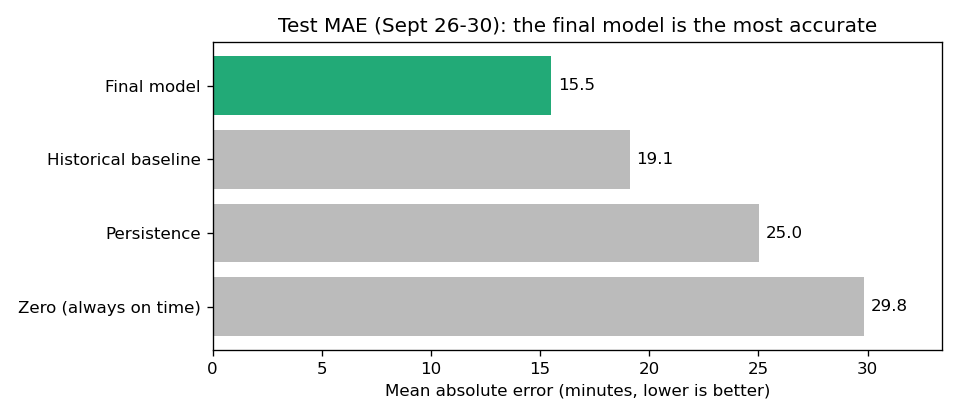
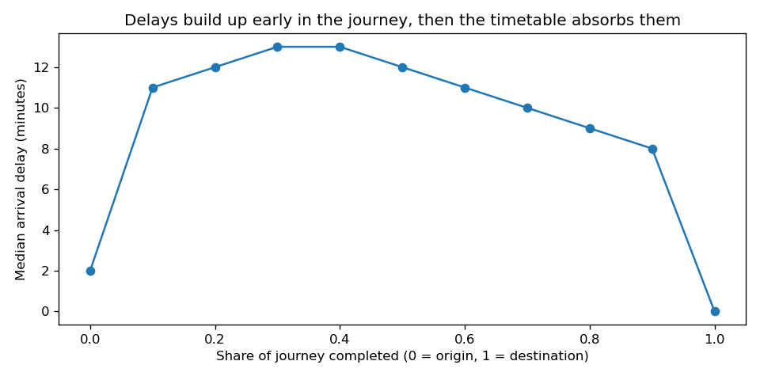
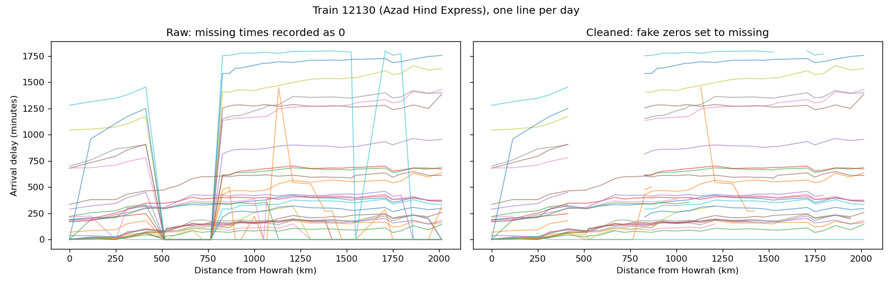
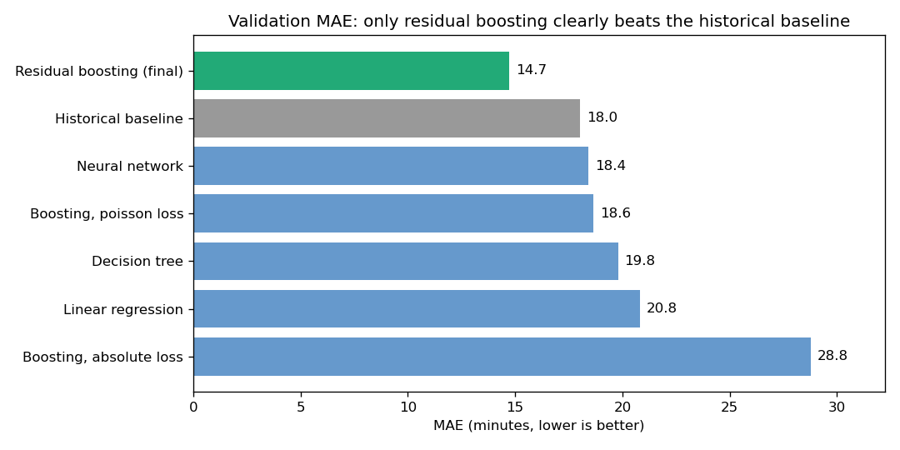
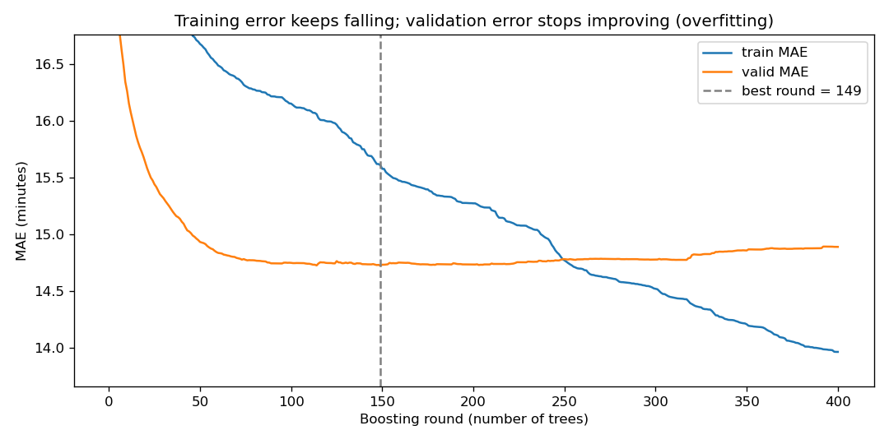
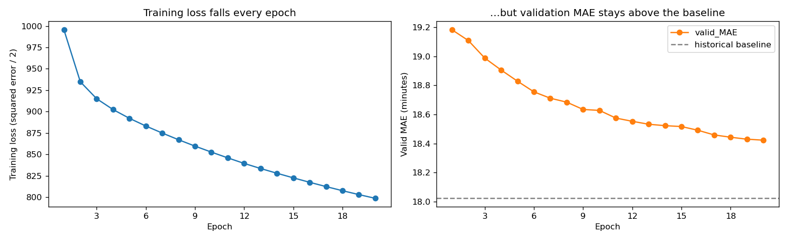
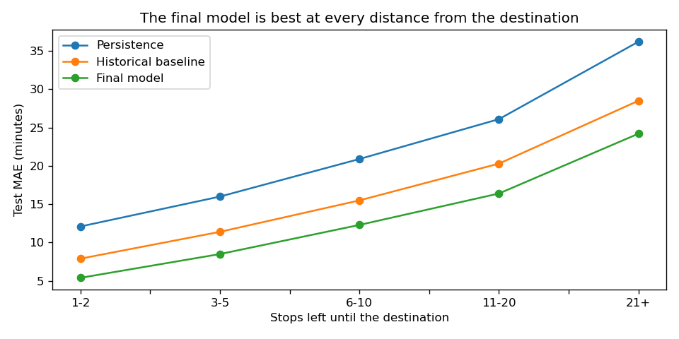
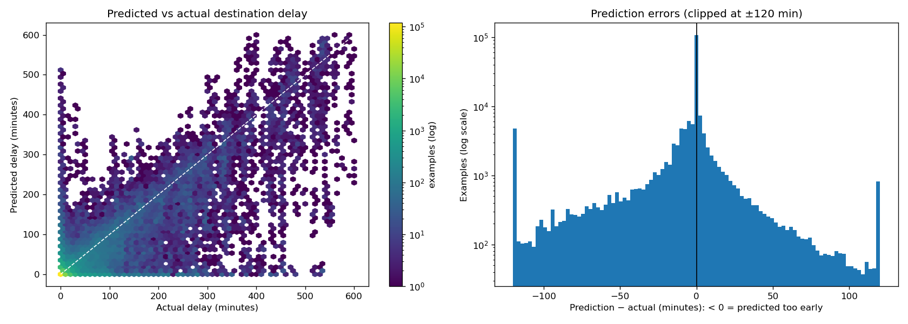

# Indian Railways: predicting arrival delays

> A train has just reached a station and is running late. **How late will it be at its final destination?**

An end-to-end machine learning project on one month (September 2024) of real Indian Railways running data: **1.28 million stop-level records, 3,892 trains and 4,736 stations.**

**Result:** on unseen dates, the final model predicts the destination delay with a **mean absolute error of 15.5 minutes**. That's **38% better** than assuming the delay stays the same, and **19% better** than a strong history-based rule. About 3 in 4 predictions are within ±10 minutes.

---

## What's in this project

The project follows the data-science workflow, one notebook per step. All code is written out in the notebooks, so every step can be read and re-run.

| # | Notebook | Step |
|---|---|---|
| 1 | [01_data_checks](01_data_checks.ipynb) | **Data quality:** types, duplicates, recalculating the target from clock times |
| 2 | [02_eda](02_eda.ipynb) | **Exploration:** delay distribution, zones, delay along the route, single-train deep dive |
| 3 | [03_data_cleaning](03_data_cleaning.ipynb) | **Cleaning:** joins, scheduled time across midnight, detecting **fake zeros** |
| 4 | [04_feature_engineering](04_feature_engineering.ipynb) | **Problem framing and features:** 23 features, date-based split, leakage-safe history features |
| 5 | [05_baselines](05_baselines.ipynb) | **Metrics and baselines:** MAE, RMSE, R², bias; three simple rules to beat |
| 6 | [06_model_training](06_model_training.ipynb) | **Training:** linear regression, decision tree, gradient boosting (round-by-round log), residual boosting, neural network (epoch-by-epoch log) |
| 7 | [07_evaluation](07_evaluation.ipynb) | **Final evaluation:** test score, predicted vs actual, error analysis, feature importance |

Run them in order: each notebook saves the files the next one needs.

## Key findings

**1. Timetables hide delays.** Trains build up delay early in the journey, but the schedule has extra time (*padding*) near the end. The median delay is about 12 minutes in the middle of a journey and **0 at the destination**. Punctuality measured only at the destination looks better than what passengers along the route experience.

**2. The raw data reports missing arrival times as "on time".** A train 11 hours late suddenly shows 0, then 30 hours late two stations later. Comparing exact zeros with genuine recoveries showed these zeros are mostly missing data: after a stop 2+ hours late, an exact 0 is about 50× more common than a real recovery of that size. **47,603 rows (3.7%)** were flagged and treated as missing.

**3. Where trains run matters.** Konkan Railway (KRCL) has a median delay of 45 minutes; Eastern Railway, 2 minutes. Stations in the iron-ore and steel belt of Jharkhand/Odisha (Chakradharpur, Rourkela, Tatanagar), where passenger trains share track with freight, are among the places where trains lose the most time.

## Modelling approach

**Task:** for every stop of a journey, predict the arrival delay at the final destination, using only what's known at that moment.

**Honest evaluation:**
- **Split by date:** train on Sept 1–20, choose models on Sept 21–25, report **one** final score on Sept 26–30. A random split would leak stops from the same journey into the test set.
- **Leakage-safe history features:** "how much this train usually gains or loses from this station" is computed only from past dates, and **out-of-fold** for training rows so no row sees its own answer.

**Models compared (validation MAE, minutes):**

| Model | MAE |
|---|---|
| **Residual boosting: historical baseline + gradient boosting (final)** | **14.7** |
| Historical baseline (no ML) | 18.0 |
| Neural network (MLP 64-32, 20 epochs) | 18.4 |
| Gradient boosting, Poisson loss | 18.7 |
| Decision tree | 19.8 |
| Linear regression | 20.8 |
| Persistence (delay stays the same) | 23.6 |
| Gradient boosting, absolute loss | 28.8 (collapsed to always predicting 0) |

**The key idea:** predicting the destination delay directly didn't beat the simple history rule. 66% of targets are exactly 0, and absolute-loss boosting got stuck at 0. Training the model to predict the **correction to a baseline** (`prediction = baseline + model`) gave the largest improvement, much more than any tuning or a neural network.

**Training curves.** Boosting was stopped at the round where validation error was lowest (~150 trees); after that it overfits. The neural network kept learning every epoch but stayed behind the simple baseline, a common result on tabular data.

**Test set (Sept 26–30):**

| Model | MAE | Within ±10 min | Within ±30 min |
|---|---|---|---|
| **Final model** | **15.5** | **75.7%** | **87.7%** |
| Historical baseline | 19.1 | 65.1% | 84.4% |
| Persistence | 25.0 | 52.7% | 78.4% |
| Always on time | 29.8 | 75.3% | 84.3% |

Special/festival trains are the hardest to predict (MAE ≈ 40 min); premium trains such as Vande Bharat and Shatabdi are very predictable (MAE under 8 min).

## Limitations
- **Large delays are underestimated.** For trains that end up 3+ hours late, the model predicts on average about 2 hours too early. Big disruptions are rare and hard to foresee from mid-journey.
- **One month of data:** no seasonal effects (monsoon, festival traffic).
- Fake zeros at the very start of a journey can't be detected, because there's no earlier stop to compare with.
- No data on track congestion, weather or maintenance blocks.

## Next steps
- Prediction **intervals** with quantile loss (e.g. "10–45 minutes late")
- A classification version: *will this train be more than 15 minutes late?*
- Network features from `IRN_edges.csv` (traffic on shared track sections)

## How to run

1. Download the dataset ("Indian Railway Network and Delays") and unzip it into `Indian-Railway-Network-and-Delays/` in the project root. It isn't stored in this repository because the files are too large for GitHub.
2. Install the requirements: `pip install -r requirements.txt`
3. Run notebooks 03 → 07 in order (about 4 minutes in total, most of it in 06). The final scores are written to `reports/test_results.csv`.
